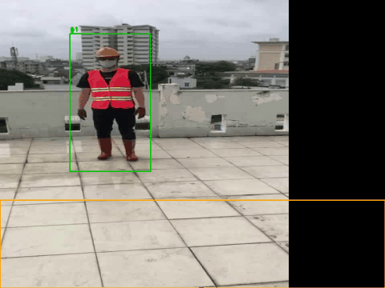

# Контроль СИЗ, опасных зон и ежедневного ТО по видео

Программа на Python подключается к видео, веб-камере или IP-камере (RTSP) и в реальном времени проверяет три вещи:
- надеты ли у людей каска и сигнальный жилет;
- не зашёл ли кто-то в опасную зону;
- подходила ли бригада к каждому узлу оборудования из регламента ежедневного ТО.

Нарушение фиксируется кадром с размытыми лицами и, если настроено, уходит в Telegram.



## Возможности

- **Детекция СИЗ.** Нейросеть YOLO, дообученная на датасете Construction-PPE, находит людей, каски и жилеты. Каска засчитывается, только если она в верхней трети рамки человека: каска в руке не считается надетой.
- **Опасные зоны.** Многоугольник задаётся в пикселях кадра. Человек в зоне, если внутри точка его ног.
- **Контроль ТО.** Узлы оборудования размечаются на кадре. Пункт выполнен, если у узла кто-то суммарно пробыл `--dwell` секунд. В конце работы программа выдаёт отчёт: что сделано, во сколько и что пропущено.
- **Без ложных тревог от одного кадра.** Люди отслеживаются между кадрами, нарушение засчитывается, только если длится дольше `--hold` секунд, и уведомление приходит одно на эпизод.
- **Приватность.** На сохранённых кадрах лица размываются, распознавания личности нет.
- **Уведомления.** Отправка снимка в Telegram через Bot API, токен берётся из переменных окружения.

## Как это работает

```
кадр ─► YOLO (люди, каски, жилеты) ─► IoU-трекер людей ─► правила ─► Hold (порог по времени) ─► снимок + Telegram
                                                          │
                                                          └─► Checklist (время у узлов ТО) ─► отчёт по смене
```

Всё в одном файле [siz_demo.py](siz_demo.py), примерно 270 строк:

| Часть | Что делает |
|---|---|
| `person_problems` | правила «без каски», «без жилета», «в опасной зоне» для одного человека |
| `in_polygon` | проверка точки в многоугольнике методом луча, без зависимостей |
| `IouTracker` | номера людей между кадрами по перекрытию рамок |
| `Hold` | нарушение засчитывается после N секунд, одно уведомление на эпизод |
| `Checklist` | пункты ТО по суммарному времени у узла |
| `blur_faces` | размытие лиц каскадом Хаара из OpenCV |

**Почему свой трекер, а не встроенный ByteTrack.** Трекер YOLO отдаёт только подтверждённые треки. При смене сцены он терял только что появившуюся каску, и человек в каске получал ложное «без каски». Поэтому детекции берутся из `predict`, а трекаются только люди.

## Результаты

Модель YOLOv8s дообучалась на открытом датасете [Construction-PPE](https://docs.ultralytics.com/datasets/detect/construction-ppe/): 1132 фото для обучения, 143 для проверки. Обучение на GTX 1660 Ti шло 36 эпох, взяты веса лучшей эпохи.

| Класс | Precision | Recall | mAP50 | mAP50-95 |
|---|---|---|---|---|
| каска (`helmet`) | 0,82 | 0,83 | **0,83** | 0,44 |
| жилет (`vest`) | 0,75 | 0,83 | **0,82** | 0,50 |
| человек (`Person`) | 0,80 | 0,89 | **0,89** | 0,50 |

Программа использует только эти три класса. Остальные классы датасета (перчатки, очки, `no_*`) у модели слабее, например mAP50 для `no_goggle` — 0,13, и в правилах они не участвуют.

Проверено на демо-видео:
- из 12 незнакомых фото на 11 ложных тревог нет. На 12-м рабочий срезан краем кадра, и модель не видит его каску;
- опасная зона срабатывает ровно через заданные 2,0 с, одно событие на человека;
- в тесте ТО засчитаны 2 узла из 3, а третий, у которого никого не было, попал в отчёт как пропущенный;
- скорость — 17,9 кадра/с на GTX 1660 Ti с YOLOv8s.

## Быстрый старт

```bash
python -m venv .venv
.venv/Scripts/python -m pip install -r requirements.txt   # Linux/macOS: .venv/bin/python
.venv/Scripts/python siz_demo.py --source 0 --show        # веб-камера, только опасная зона
```

Стандартная модель `yolov8n.pt` (скачается сама) видит только людей, поэтому проверяется только зона. Каски и жилеты видит обученная модель СИЗ: скачай [ppe_yolov8s.pt](https://github.com/grozeser/siz-vision-src/releases/download/v1.0/ppe_yolov8s.pt) (22 МБ) из релиза и передай в `--model`.

```bash
# видео + модель СИЗ + опасная зона + три узла ТО, с записью размеченного видео
python siz_demo.py --source video.mp4 --model ppe.pt \
  --zone "0,500;960,500;960,720;0,720" \
  --point "Лебёдка=80,860;220,860;220,950;80,950" --point "Двигатель=680,840;800,840;800,920;680,920" \
  --dwell 5 --save out.mp4
```

| Параметр | Что значит |
|---|---|
| `--source` | файл, номер веб-камеры или `rtsp://логин:пароль@ip/...` |
| `--model` | веса YOLO. Программа сама понимает по названиям классов, умеет ли модель находить каски (`helmet`, `hardhat`) и жилеты (`vest`, `safety-vest`) |
| `--zone` | опасная зона: `"x,y;x,y;x,y"` в пикселях кадра |
| `--point` | узел ТО: `"Название=x,y;x,y;x,y"`, можно указать несколько раз. На кадре узлы подписаны T1, T2…, а названия выводятся в отчёте |
| `--hold` | сколько секунд должно длиться нарушение, по умолчанию 2 |
| `--dwell` | сколько секунд нужно пробыть у узла ТО, по умолчанию 5 |
| `--conf` | порог уверенности детектора, по умолчанию 0,4 |
| `--save` | записать видео с рамками |
| `--show` | показывать окно, `q` — выход |

Telegram: создай бота у @BotFather и перед запуском задай `TELEGRAM_TOKEN` и `TELEGRAM_CHAT_ID`. Без них снимки только сохраняются в `violations/`.

## Обучение модели СИЗ

```bash
yolo detect train data=construction-ppe.yaml model=yolov8s.pt epochs=50 imgsz=640 batch=16 device=0
```

Датасет скачается сам, веса будут в `runs/detect/train/weights/best.pt`. Лучшая эпоха была около 30-й, дальше точность почти не росла, поэтому хватит 25–35 эпох. Для видеокарты нужен torch с CUDA (https://pytorch.org/get-started/locally/), причём torchvision тоже должен быть CUDA-сборки. На GTX 1660 Ti одна эпоха занимает около 5 минут.

## Тесты

```bash
python test_siz.py
```

Тест проверяет логику без нейросети: правила СИЗ (в том числе каску в руке), геометрию зон, порог по времени, трекер и чек-лист ТО. Тяжёлые библиотеки ему не нужны, поэтому он запускается в GitHub Actions на каждый push.

## Ограничения и что дальше

- Трекер теряет номер человека, если детектор пропустил его хоть на один кадр. Следующий шаг — трекер с памятью.
- Каскад Хаара пропускает лица в профиль и в масках. Следующий шаг — нейросетевой детектор лиц YuNet.
- ТО засчитывается по присутствию у узла, а не по самому действию. Следующий шаг — распознавание действий по позе рук.
- OpenCV не рисует кириллицу, поэтому подписи на кадре латиницей.
- Отчёт ТО формируется в конце видео, а не по расписанию смены.

## Стек и лицензии

Python 3.12, [Ultralytics YOLO](https://github.com/ultralytics/ultralytics), OpenCV, PyTorch.

Код распространяется по лицензии [AGPL-3.0](LICENSE), как и Ultralytics и датасет Construction-PPE, на которых он построен.
